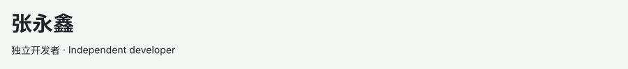

  

  有洁癖的完美主义者，做独立开发。 
  A neat-freak perfectionist, building on my own. · <!-- STATS:START -->近 14 天 <strong>57</strong> 次提交 · 7 日活跃 <strong>8</strong> 个仓库<!-- STATS:END --> · <a href="https://gist.github.com/hey-yx">公开 Gist ↗</a>

<h3>最近在做</h3>
<!-- ACTIVE:START --><table>
<tr><td width="50%" valign="top"> <strong><a href="https://github.com/hey-yx/seal-maker">seal-maker</a></strong> 精仿生成中国公司电子印章图像：四类模板、标准与实盖扫描两种质感，42/40 mm，600 dpi 透明 PNG</td><td width="50%" valign="top"> <strong><a href="https://github.com/hey-yx/sxeasy">sxeasy</a></strong> 面向线上实习场景的一站式平台：覆盖签约、工牌、打卡周报、企业协作、订单履约与后台运营。</td></tr>
<tr><td width="50%" valign="top"> <strong><a href="https://github.com/hey-yx/ui-specs">UISpecs</a></strong> 给 AI 用的 UI 设计规范原文库。收官方规范全文，每个页面数值都能定位到文章具体行号。</td><td width="50%" valign="top"> <strong><a href="https://github.com/hey-yx/zhifufm-sdk">zhifufm-sdk</a></strong> 支付FM V2 轻量 TypeScript/Bun/Node SDK：RSA2 签名验签、下单、查单与收银台兜底、异步回调核验</td></tr>
<tr><td width="50%" valign="top"> <strong><a href="https://github.com/hey-yx/portfolios">portfolios</a></strong> 张永鑫的个人作品集。展示项目交付、技术文章、工作片段和联系方式。</td><td width="50%" valign="top"> <strong><a href="https://github.com/hey-yx/stamp-extractor">stamp-extractor</a></strong> 把纸面盖章照片抠成透明底 PNG 的纯前端工具，零依赖，图片不上传</td></tr>
<tr><td width="50%" valign="top"> <strong><a href="https://github.com/hey-yx/seal-maker-public">seal-maker-public</a></strong> 标准印章生成器公开版：精仿合同、财务专用章，四种可用样式，浏览器本地生成</td><td width="50%" valign="top"> <strong><a href="https://github.com/hey-yx/NameYouLike">NameYouLike</a></strong> 描述你的产品，拿到 8 个能用的英文名和推荐域名。</td></tr>
</table><!-- ACTIVE:END -->

<h3>最近更新</h3>
<!-- RECENT:START --><table>
<thead><tr><th>日期</th><th>项目</th><th>动态</th></tr></thead>
<tbody>
<tr><td><code>11&#8209;22</code></td><td><a href="https://github.com/hey-yx/ui-specs/commit/10dbe67680d31fc774bbb3c6e947d9b1629f8e9c">UISpecs</a></td><td>rebuild anyttl case with current project prompt</td></tr>
<tr><td><code>11&#8209;22</code></td><td><a href="https://github.com/hey-yx/portfolios/commit/036c25aa08cda774ab91f5262ec6479c74c09631">portfolios</a></td><td>必应壁纸走 CF Worker 元数据直连 bing，后台预取 8 张零等待</td></tr>
<tr><td><code>11&#8209;22</code></td><td><a href="https://github.com/hey-yx/stamp-extractor/commit/c9f00769d9a0837522f41a610ee65dabfe4b1392">stamp-extractor</a></td><td>initialize clean repository with compliance updates</td></tr>
<tr><td><code>11&#8209;22</code></td><td><a href="https://github.com/hey-yx/seal-maker/commit/22e23da2b1e066215cb61f831004e34c8cdeea41">seal-maker</a></td><td>initialize clean repository with compliance updates</td></tr>
<tr><td><code>11&#8209;21</code></td><td><a href="https://github.com/hey-yx/ui-specs/commit/d66b98410241ff1908f461dec410415156ce9c4f">UISpecs</a></td><td>精简 README 与精选封面，扁平化重跑 EpDeck 案例</td></tr>
<tr><td><code>11&#8209;21</code></td><td><a href="https://github.com/hey-yx/portfolios/commit/bee5f2ff7d6b381456c5d4a1f5f2f2744ac9e040">portfolios</a></td><td>子路径相对图标地址按目录解析；原位松手补发单击跳转</td></tr>
</tbody>
</table><!-- RECENT:END -->

  

